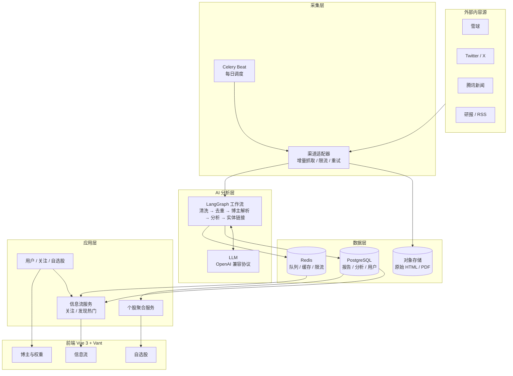
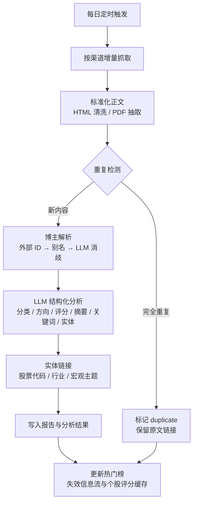
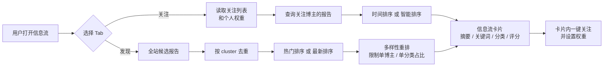
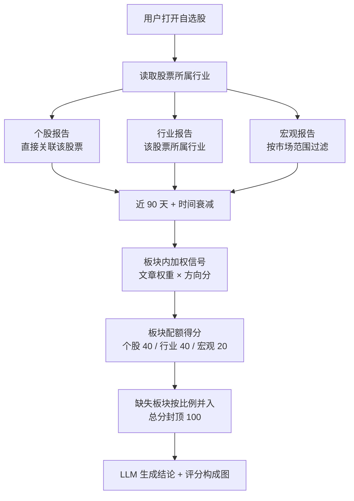

# research-scout-agent

> 把财经研报、论坛帖子和新闻，变成可解释、可个性化的研究信号。

每天自动从新浪财经、华尔街见闻、腾讯新闻、雪球、Twitter/X 等渠道采集内容，用 LLM 完成**分类、方向评分、摘要、关键词和实体识别**；用户关注自己信任的博主并设置权重，在信息流中高效阅读；把股票加入自选后，系统按**个股、行业、宏观**三类信号聚合出综合评分与 AI 结论。

> 当前状态：**Local MVP 已可运行**（FastAPI 后端 + Vue/Vant 移动端前端）。已实现新浪财经、华尔街见闻与 Mock 渠道，腾讯新闻 / 雪球 / Twitter-X 在路线图中。完整设计见 [docs/architecture-design.md](docs/architecture-design.md)。

---

## 目录

- [快速开始](#快速开始)
- [1. 它解决什么问题](#1-它解决什么问题)
- [2. 核心概念](#2-核心概念)
- [3. 系统总览](#3-系统总览)
- [4. 核心流程](#4-核心流程)
- [5. 评分逻辑](#5-评分逻辑)
- [6. 关键设计](#6-关键设计)
- [7. 技术栈](#7-技术栈)
- [8. MVP 范围与路线图](#8-mvp-范围与路线图)
- [9. 项目结构](#9-项目结构)
- [10. 文档](#10-文档)
- [免责声明](#免责声明)

---

## 快速开始

### 方式一：Docker Compose（推荐）

```bash
cp .env.example .env
# 至少修改 JWT_SECRET；接真实模型时填写 LLM_API_KEY 并设置 LLM_MOCK=false

docker compose up -d --build
# 首次启动会执行 Alembic 迁移并写入渠道、行业与 A 股基础数据

# 可选：首次启动时加载演示数据（Mock 研报、演示用户、关注与自选）
SEED_DEMO_DATA=true docker compose up -d --build
```

打开 <http://localhost:8080>。后端 OpenAPI 文档：<http://localhost:8000/docs>。

| 账号 | 密码 | 说明 |
|---|---|---|
| `demo@example.com` | `demo12345` | 演示用户（需开启 `SEED_DEMO_DATA`） |
| `admin@example.com` | `admin123456` | 管理员（来自 `ADMIN_EMAIL` / `ADMIN_PASSWORD`） |

### 方式二：本地开发

```bash
cp .env.example .env
# 没有 PostgreSQL 时，把 DATABASE_URL 改为：
# DATABASE_URL=sqlite+aiosqlite:///./research_scout.db

make install       # 创建 .venv，安装后端 + 前端依赖
make seed-demo     # 写入基础数据、Mock 研报、演示用户与自选股
make dev-backend   # FastAPI  :8000
make dev-frontend  # Vite     :5173（/api 代理到 :8000）
```

打开 <http://localhost:5173>。

- `LLM_MOCK=true`（默认）时使用确定性的本地分析器，无需 API Key，适合开发与测试；
- 接入真实模型时设置 `LLM_MOCK=false`、`LLM_BASE_URL`、`LLM_API_KEY`，模型默认 `deepseek-v4-flash`；
- 数据库迁移：`cd backend && alembic upgrade head`；本地默认 `AUTO_CREATE_TABLES=true`，启动时会自动建表；
- **启动自动刷新**：后端启动后会在后台检查最近一次成功抓取的时间。1 小时内则跳过；超过 1 小时（或从未成功抓取）则立即抓取并分析。可用 `STARTUP_REFRESH_ENABLED`、`STARTUP_REFRESH_STALE_MINUTES` 调整，长任务不会阻塞服务启动。

### 测试与检查

```bash
make test   # 后端 pytest（36 项）
make lint   # ruff + vue-tsc
make build  # 前端生产构建
```

### 当前已实现的能力

| 能力 | 状态 |
|---|---|
| 渠道适配器（新浪财经、华尔街见闻、Mock） | ✅ 已实现，含列表 + 详情正文抓取、重试与限流 |
| 报告清洗、内容哈希、SimHash 转载聚类 | ✅ 已实现 |
| LangGraph 分析流水线（分类 / 评分 / 摘要 / 观点 / 关键词 / 实体） | ✅ 已实现，LLM 失败自动降级到规则分析 |
| 多用户注册、登录、JWT 刷新 | ✅ 已实现 |
| 作者解析、别名、关注与个人权重 | ✅ 已实现，支持手动添加作者 |
| 关注流 / 发现热门流、多样性重排、游标分页 | ✅ 已实现 |
| 自选股、三层聚合评分、AI 结论、评分快照 | ✅ 已实现 |
| 移动端前端（首页 / 自选 / 作者 / 我的 / 详情） | ✅ 已实现 |
| Celery 定时采集与分析 | ✅ 已接入（Docker Compose 含 worker / beat） |
| 启动时按新鲜度自动抓取 | ✅ 已实现，最近成功抓取 1 小时内跳过 |
| 腾讯新闻、雪球、Twitter/X 适配器 | 🚧 路线图 |
| 管理端 UI、PDF 研报解析、pgvector 语义检索 | 🚧 路线图 |

---

## 1. 它解决什么问题

财经信息的问题通常不是“没有内容”，而是：

- 内容太多，来源太杂，质量参差不齐；
- 同样一篇研报被多个渠道反复转载，信息被放大；
- 论坛观点、机构研报、宏观新闻混在一起，难以形成判断；
- 每个人信任的博主不同，但大多数产品只提供统一排序；
- 自选股需要同时考虑个股、行业、宏观三层信息，手工汇总成本高。

本系统把内容处理拆成三层：

```text
内容层：渠道适配器 → 稳定拿到原始内容
分析层：AI 全局分析一次 → 分类、评分、摘要、实体
个性化层：用户权重 + 关注 + 自选股 → 组合出个人视角的信息流与个股评分
```

**全局分析一次，个性化组合多次。** 这是控制 LLM 成本、同时支持多用户的关键。

---

## 2. 核心概念

| 概念 | 说明 | 谁来维护 |
|---|---|---|
| **渠道** | 内容来源，如雪球、Twitter/X、腾讯新闻、研报源 | 代码维护适配器；管理端只启停和改配置 |
| **博主** | 内容发布者或署名机构，如雪球用户、高盛、摩根大通 | 系统自动解析 + 用户可添加 + 管理员可合并 |
| **报告** | 一篇帖子、新闻或研报（含 PDF） | 系统每日自动抓取 |
| **分析** | AI 对报告的分类、评分、摘要、关键词、实体 | 全局共享，可版本化、可重跑 |
| **关注** | 用户与博主的关系，带个人权重 | 用户维护 |
| **自选股** | 用户关注的股票 | 用户维护 |
| **聚合评分** | 某用户视角下，某只股票的综合评分与结论 | 按用户 + 股票 + 日期生成快照 |

### 三种权重

系统中有三种不同的权重，UI 和命名必须区分：

| 权重 | 作用域 | 含义 | 默认值 |
|---|---|---|---|
| 博主默认权重 | 全局 | 博主的基础可信度/影响力 | 1.0 |
| 用户关注权重 | 用户 | 当前用户对该博主的个人信任权重 | 1.0 |
| 分类权重 | 用户 | 个股 / 行业 / 宏观在个股聚合中的占比 | 1.0 / 0.5 / 0.25 |

用户视角下的有效博主权重：

```text
用户关注了该博主 → 使用 follows.weight
否则             → 使用 authors.default_weight
```

---

## 3. 系统总览



### 分层职责

| 层 | 负责 | 不负责 |
|---|---|---|
| 客户端 | 展示、筛选、权重编辑、自选股管理 | 业务计算、权限判断 |
| API 层 | 认证、参数校验、限流、序列化 | 复杂业务逻辑 |
| 应用服务层 | 领域编排、事务、缓存、权限 | 爬虫与 Prompt |
| Agent/任务层 | 采集、AI 分析、聚合、评测、重试 | 面向用户的同步请求 |
| 数据层 | 持久化、缓存、向量检索、原始文件 | 业务规则 |

---

## 4. 核心流程

### 4.1 每日采集与 AI 分析



关键点：

- **增量抓取**：按 `external_id` 和发布时间游标增量，避免全量重扫；
- **三级去重**：渠道内幂等 → 内容哈希 → 转载聚类（同一观点只算一次）；
- **博主解析**：渠道身份 `(channel_id, external_id)` → 别名精确匹配 → 规范化名称匹配 → 保守模糊匹配（阈值 0.9 且唯一最优）→ 新建作者；
- **结构化输出**：分析结果必须通过 Pydantic Schema 校验，不合法则重试/降级；
- **失败隔离**：单个渠道、单篇报告失败不阻塞整体任务。

### 4.2 信息流：关注 + 发现/热门



#### 关注流

- 候选集：用户关注的博主；
- 默认“智能排序”，可切换“最新”；
- 智能排序会考虑：用户权重、时效、评分置信度、方向强度；
- 同一转载 cluster 只展示一次；翻页使用游标（offset 编码），并做作者 / 分类多样性约束。

#### 发现 / 热门流

- 候选集：全站报告，支持 24 小时 / 72 小时 / 7 天窗口；
- “热门”使用全局博主权重计算，不依赖当前用户，因此可以全站缓存；
- “最新”按发布时间倒序；
- 热门分公式：

```text
signal = 0.5 + 0.5 × confidence × |score|

heat = default_weight^0.5
     × 0.5^(age_hours / 48)
     × signal
     × (1 + 0.15 × ln(1 + reprint_count))
     × (1 + 0.10 × ln(1 + engagement))
```

- `reprint_count`：同一内容被多少渠道转载，体现跨平台热度；
- `engagement`：点赞/评论/阅读等互动量，渠道提供时使用，取不到按 0；
- 同一 `cluster` 只保留代表报告；
- 每 20 条中，同一博主最多 2 条，同一主分类最多 6 条，避免热门榜被单一事件刷屏；
- 卡片上可直接关注作者，关注后内容也会进入关注流。

### 4.3 个股聚合评分



- 默认纳入**全站报告**（`scope=all`），用户可切换为**仅关注博主**（`scope=followed`）；
- **只纳入近 90 天**的报告，更早的文章不参与评分；
- 板块配额默认：个股 40 / 行业 40 / 宏观 20；某板块没有相关报告时，其配额按比例并入其余板块；
- 时间衰减半衰期：个股 7 天 / 行业 14 天 / 宏观 30 天，越新的文章权重越高；
- 同一篇报告被多个渠道转载时，按 cluster 只计算一次；
- 个股页展示总分（0–100）、板块得分、文章权重拆解与评分构成图；
- 每次评分保存快照，记录当时的权重配置、参与报告、分项得分和模型版本，能回答“为什么是这个分”。

---

## 5. 评分逻辑

### 5.1 报告级评分

每篇报告输出：

| 字段 | 范围 | 含义 |
|---|---|---|
| `score` | -1.0 ~ +1.0 | 对相关标的/行业/市场的方向性影响 |
| `confidence` | 0 ~ 1 | 模型对判断的置信度 |
| `direction` | bullish / bearish / neutral | UI 展示与筛选 |
| `horizon` | short / medium / long | 影响时效判断 |

> 报告级 `score` 只作为聚合输入。信息流与研报详情页**不展示单篇分数**，只在个股页展示综合评分及其构成。UI 遵循 A 股习惯：**红涨绿跌**。

### 5.2 个股综合评分

#### 第一步：筛选与时间衰减

只纳入**最近 90 天**的相关报告。每篇报告的有效权重为：

```text
w_i = confidence_i
    × sqrt(author_weight_i)
    × relevance_i
    × 0.5^(age_days_i / half_life_days_i)
```

默认半衰期：

| 板块 | 半衰期 | 含义 |
|---|---:|---|
| 个股 | 7 天 | 个股消息衰减最快 |
| 行业 | 14 天 | 行业景气变化中等 |
| 宏观 | 30 天 | 宏观环境变化最慢 |

例如一篇 30 天前的个股报告，权重只剩 `0.5^(30/7) ≈ 5.2%`；同样 30 天前的宏观报告仍有 `50%`。

#### 第二步：板块内加权信号

对每个板块 `c`（个股 / 行业 / 宏观）：

```text
signal_c = Σ(w_i × score_i) / Σw_i        # 范围 [-1, 1]
```

先除以权重之和，避免“文章越多分数越极端”。

#### 第三步：按 40 / 40 / 20 分配板块配额

```text
base = { stock: 0.40, industry: 0.40, macro: 0.20 }
```

只保留有相关报告的板块，并把缺失板块的配额按比例分给其余板块：

```text
share_c = base_c / Σ(base_j for j in present_categories)
budget_c = 100 × share_c
```

例如只有个股和宏观报告时，配额变为个股 `66.7`、宏观 `33.3`；只有个股报告时，个股拿满 `100`。

#### 第四步：板块得分与总分

```text
points_c = (signal_c + 1) / 2 × budget_c
total_points = Σ points_c                  # 0 ≤ total_points ≤ 100
```

- `signal = 0`（中性）→ 拿到该板块一半配额；
- `signal = +1`（全部看多）→ 拿满配额；
- `signal = -1`（全部看空）→ 该板块得 0 分；
- 三个板块相加即为 0–100 的综合得分。

#### 参考实现

```python
# 仅保留近 90 天
if age_days > 90:
    continue

decay = 0.5 ** (age_days / half_life[category])
w = confidence * math.sqrt(author_weight) * relevance * decay

signal[category] += w * score
weight_sum[category] += w

# 板块信号
signal_c = signal[c] / weight_sum[c]

# 缺失板块重新分配配额后
points_c = (signal_c + 1) / 2 * budget_c
total_points = sum(points_c)
```

- 数值完全由公式决定，可复现、可回测；
- LLM 只负责写结论文字，**不修改分数**；
- 同时保存 `total_points`、各板块 `points / budget`、文章级权重拆解，前端据此绘制评分构成图；
- `n_eff` 与 `confidence` 仅作为“证据广度”展示，不再对分数做收缩。

### 5.3 为什么这样设计

- **板块配额固定**：避免某一类文章数量多就主导结论；
- **缺失板块配额重分配**：没有行业报告时，不让总分被凭空扣掉 40 分；
- **时间衰减 + 90 天硬截止**：让评分反映当前观点，而不是长期历史平均；
- **板块内先归一化**：文章数量不影响信号强度，只影响证据广度；
- **全局分析不按用户重复调用**：控制 LLM 成本；
- **评分数值与解释分离**：避免 LLM 幻觉出一个无法解释的分数；
- **聚类去重**：防止转载放大同一观点；
- **快照机制**：权重变化后历史评分不被篡改，便于回看与复盘。

---

## 6. 关键设计

- **渠道适配器插件化**：每个渠道一个 Adapter，新增渠道 = 新增代码 + 注册配置，不在 UI 里创建渠道；
- **渠道内 fallback 链**：官方 API/RSS → 自建 RSSHub → 列表页解析 → 浏览器渲染兜底，单渠道故障不阻塞全局；
- **主分类 + 多标签**：一篇研报可以同时是个股和行业，聚合时使用全部标签；
- **双层博主权重**：全局默认权重 + 用户个人权重，用户权重覆盖全局；
- **三级去重**：渠道幂等 → 内容哈希 → 转载聚类；
- **LangGraph 确定性工作流**：日常分析不用自由 ReAct Agent，保证成本、延迟、可重试性；
- **固定工具 + LLM 归因**：个股聚合的数据查询走确定性 SQL，LLM 只负责组织结论；
- **提示注入防护**：抓取内容视为不可信输入，分析节点不挂工具，输出严格校验；
- **多用户隔离**：所有用户私有查询在 Service 层强制注入 `user_id`；
- **可观测**：采集、分析、聚合、LLM 成本全部有指标和日志。

---

## 7. 技术栈

| 层 | 选型 |
|---|---|
| 后端 | Python 3.11+ · FastAPI · SQLAlchemy 2（async）· Alembic |
| Agent | LangChain · LangGraph（确定性 `prepare → analyze → normalize` 图） |
| 任务 | Celery · Redis |
| 数据库 | PostgreSQL 16；开发可用 SQLite；pgvector 为后续计划 |
| 缓存/队列 | Redis 7 |
| 前端 | Vue 3 · TypeScript · Vite · Pinia · Vue Router |
| UI | Vant 4（移动端优先）；图表计划接入 ECharts |
| LLM | OpenAI 标准协议，默认 `deepseek-v4-flash`；本地支持 `LLM_MOCK` 规则降级 |
| 测试 | pytest · Ruff · vue-tsc |
| 部署 | Docker Compose · Nginx（后续可迁 Kubernetes） |

### LLM 接入

统一使用 OpenAI 兼容协议：

```text
LLM_PROTOCOL=openai
LLM_BASE_URL=<OpenAI 兼容端点>
LLM_API_KEY=<key>
LLM_MODEL_UTILITY=deepseek-v4-flash
LLM_MODEL_ANALYZE=deepseek-v4-flash
LLM_MODEL_AGGREGATE=deepseek-v4-flash
```

代码只依赖 LangChain 的 ChatModel 接口，后续换模型或供应商只改环境变量。

---

## 8. MVP 范围与路线图

### MVP（Local MVP 已落地）

- **渠道**：新浪财经、华尔街见闻、Mock 三个适配器；腾讯新闻、雪球、Twitter/X 待接入；
- 每日定时增量采集（Celery Beat），支持手动 CLI 抓取；
- 报告分类、方向评分、置信度、摘要、观点、关键词、实体识别；
- 多用户注册/登录、JWT access + refresh；
- 关注博主 + 个人权重、手动添加作者；
- **关注信息流**（智能 / 最新）；
- **发现/热门信息流**（热门 / 最新 + 时间窗口 + 多样性重排）；
- 自选股 + 个股/行业/宏观三层聚合评分 + AI 结论 + 评分快照；
- 默认全站聚合（`scope=all`），用户可切换仅关注（`scope=followed`）；
- **A 股**证券主数据、行业映射与搜索；
- 管理 API：渠道启停、手动触发采集/分析、任务与统计查看（管理 UI 待做）；
- Vue + Vant 移动端前端：首页、研报详情、自选、个股详情、作者、设置。

### 尚未完成

- 腾讯新闻、雪球、Twitter/X 适配器；
- 管理端 Web UI、作者合并 UI；
- PDF 研报解析、对象存储、pgvector 语义检索；
- 博主历史准确率、组合评分、通知与 RAG 问答。

### 首批渠道与接入优先级

| 优先级 | 渠道 | 接入方式 | 说明 |
|---|---|---|---|
| P0 | 新浪财经 | 列表 API / 自建 RSSHub | ✅ 已实现：滚动新闻 API + 详情正文 |
| P0 | 华尔街见闻 | 热榜 API + 7x24 快讯 | ✅ 已实现：文章列表 + 详情 API（`extract=0`） |
| P1 | 腾讯新闻 | 财经频道/搜索 + 列表 API | 列表自带 `source` 发布者字段，适合博主解析 |
| P1 | 雪球 | 登录态 API / 自建 RSSHub | 作者关注的核心来源，但 cookie/反爬维护成本最高 |
| P2 | Twitter/X | 官方 API v2 | 配额与费用，按账号/关键词抓取 |
| P2 | 研报源 / PDF | RSS / 开放接口 / PDF | 价值高，解析与版权复杂度高 |

> 公共 RSSHub 实例不稳定，生产环境建议自建。渠道适配器内部按“官方 API/RSS → 自建 RSSHub → 列表页 → 浏览器渲染”降级，浏览器只做最后兜底。

### 路线图

| 阶段 | 目标 | 状态 |
|---|---|---|
| Phase 0 | 工程骨架、数据模型、认证、新浪财经 + 华尔街见闻 | ✅ 完成 |
| Phase 1 | AI 分析流水线、关注流、发现/热门、博主与权重 | ✅ 完成（腾讯/雪球待接入） |
| Phase 2 | A 股主数据、自选股、聚合评分、结论与快照 | ✅ 完成 |
| Phase 3 | 转载聚类、评测体系、管理端、成本与性能优化 | 🚧 聚类已实现；评测与管理 UI 待做 |
| Phase 4 | 博主历史准确率、组合评分、RAG 问答、通知 | ⏳ 规划中 |

---

## 9. 项目结构

```text
research-scout-agent/
├── backend/
│   ├── app/
│   │   ├── api/             # FastAPI 路由（auth / authors / feed / watchlist / admin）
│   │   ├── agents/          # LangGraph 分析图、Prompt、LLM 调用、规则降级
│   │   ├── collectors/      # 渠道适配器（sina / wallstreetcn / mock）+ 注册表
│   │   ├── core/            # 配置与常量
│   │   ├── db/              # Base、UTC 类型、async session
│   │   ├── models/          # SQLAlchemy 模型
│   │   ├── schemas/         # Pydantic Schema
│   │   ├── scoring/         # 文本哈希、SimHash、热度、个股聚合公式
│   │   ├── services/        # 采集、分析、作者、信息流、自选、认证、种子数据
│   │   ├── tasks/           # Celery app 与定时任务
│   │   ├── cli.py           # init-db / seed / seed-demo / crawl / analyze
│   │   └── main.py
│   ├── alembic/             # 初始迁移（versions/）
│   ├── tests/               # pytest（评分、文本、采集、API 流程）
│   ├── Dockerfile
│   └── pyproject.toml
├── frontend/
│   ├── src/
│   │   ├── api/             # 类型、token、fetch 客户端（自动刷新）
│   │   ├── components/      # ScoreRing、ReportCard
│   │   ├── pages/           # 登录、首页、详情、作者、自选、个股、设置
│   │   ├── stores/          # Pinia：auth / feed / watchlist
│   │   ├── router/
│   │   ├── styles/          # 移动端金融主题
│   │   └── utils/
│   ├── nginx.conf           # SPA + /api 反向代理
│   ├── Dockerfile
│   └── vite.config.ts
├── docs/
│   └── architecture-design.md
├── docker-compose.yml       # Postgres / Redis / backend / worker / beat / frontend
├── Makefile
├── .env.example
└── README.md
```

---

## 10. 文档

- [架构设计文档](docs/architecture-design.md)：数据模型、采集、LangGraph 流水线、评分公式、API、前端、部署与路线图。
- [参考项目调研](docs/architecture-design.md#56-参考项目调研cn-news-digest)：对 `cn-news-digest` 的来源清单、实测结果与质量评估（仅借鉴思路，不复制代码）。

---

## 免责声明

本系统输出的分类、评分、摘要和结论均由 AI 基于公开内容生成，仅供研究参考，**不构成任何投资建议**。用户应自行判断信息可靠性与投资风险。
