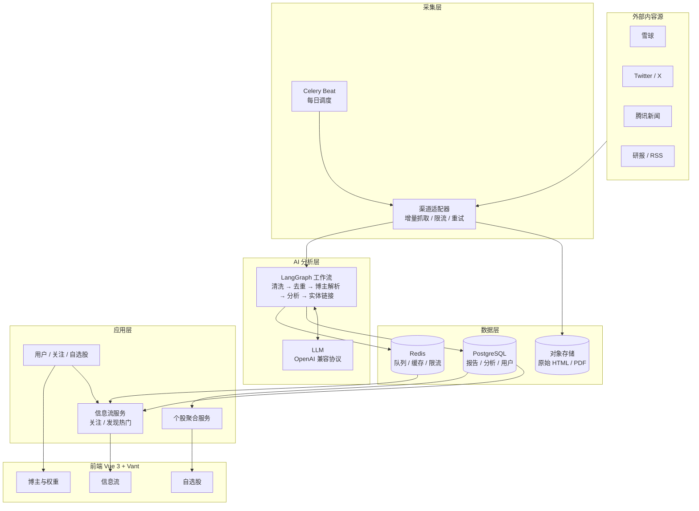
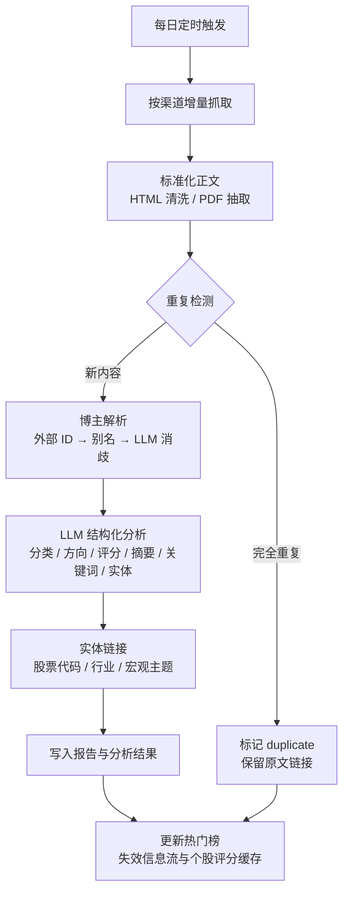
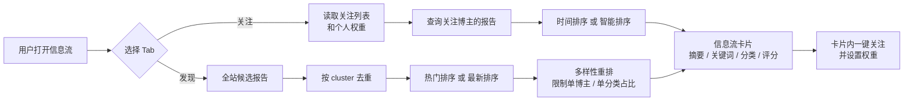
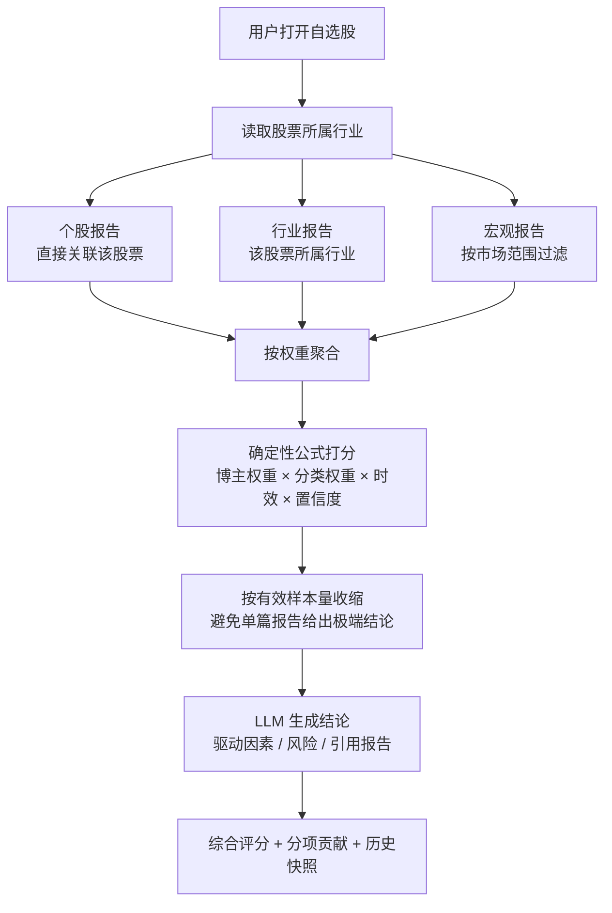

# research-scout-agent

> 把财经研报、论坛帖子和新闻，变成可解释、可个性化的研究信号。

每天自动从雪球、Twitter/X、腾讯新闻等渠道采集内容，用 LLM 完成**分类、方向评分、摘要、关键词和实体识别**；用户关注自己信任的博主并设置权重，在信息流中高效阅读；把股票加入自选后，系统按**个股、行业、宏观**三类信号聚合出综合评分与 AI 结论。

> 当前状态：架构设计阶段。完整设计见 [docs/architecture-design.md](docs/architecture-design.md)。

---

## 目录

- [1. 它解决什么问题](#1-它解决什么问题)
- [2. 核心概念](#2-核心概念)
- [3. 系统总览](#3-系统总览)
- [4. 核心流程](#4-核心流程)
- [5. 评分逻辑](#5-评分逻辑)
- [6. 关键设计](#6-关键设计)
- [7. 技术栈](#7-技术栈)
- [8. MVP 范围与路线图](#8-mvp-范围与路线图)
- [9. 项目结构](#9-项目结构)
- [10. 文档](#10-文档)
- [免责声明](#免责声明)

---

## 1. 它解决什么问题

财经信息的问题通常不是“没有内容”，而是：

- 内容太多，来源太杂，质量参差不齐；
- 同样一篇研报被多个渠道反复转载，信息被放大；
- 论坛观点、机构研报、宏观新闻混在一起，难以形成判断；
- 每个人信任的博主不同，但大多数产品只提供统一排序；
- 自选股需要同时考虑个股、行业、宏观三层信息，手工汇总成本高。

本系统把内容处理拆成三层：

```text
内容层：渠道适配器 → 稳定拿到原始内容
分析层：AI 全局分析一次 → 分类、评分、摘要、实体
个性化层：用户权重 + 关注 + 自选股 → 组合出个人视角的信息流与个股评分
```

**全局分析一次，个性化组合多次。** 这是控制 LLM 成本、同时支持多用户的关键。

---

## 2. 核心概念

| 概念 | 说明 | 谁来维护 |
|---|---|---|
| **渠道** | 内容来源，如雪球、Twitter/X、腾讯新闻、研报源 | 代码维护适配器；管理端只启停和改配置 |
| **博主** | 内容发布者或署名机构，如雪球用户、高盛、摩根大通 | 系统自动解析 + 用户可添加 + 管理员可合并 |
| **报告** | 一篇帖子、新闻或研报（含 PDF） | 系统每日自动抓取 |
| **分析** | AI 对报告的分类、评分、摘要、关键词、实体 | 全局共享，可版本化、可重跑 |
| **关注** | 用户与博主的关系，带个人权重 | 用户维护 |
| **自选股** | 用户关注的股票 | 用户维护 |
| **聚合评分** | 某用户视角下，某只股票的综合评分与结论 | 按用户 + 股票 + 日期生成快照 |

### 三种权重

系统中有三种不同的权重，UI 和命名必须区分：

| 权重 | 作用域 | 含义 | 默认值 |
|---|---|---|---|
| 博主默认权重 | 全局 | 博主的基础可信度/影响力 | 1.0 |
| 用户关注权重 | 用户 | 当前用户对该博主的个人信任权重 | 1.0 |
| 分类权重 | 用户 | 个股 / 行业 / 宏观在个股聚合中的占比 | 1.0 / 0.5 / 0.25 |

用户视角下的有效博主权重：

```text
用户关注了该博主 → 使用 follows.weight
否则             → 使用 authors.default_weight
```

---

## 3. 系统总览



### 分层职责

| 层 | 负责 | 不负责 |
|---|---|---|
| 客户端 | 展示、筛选、权重编辑、自选股管理 | 业务计算、权限判断 |
| API 层 | 认证、参数校验、限流、序列化 | 复杂业务逻辑 |
| 应用服务层 | 领域编排、事务、缓存、权限 | 爬虫与 Prompt |
| Agent/任务层 | 采集、AI 分析、聚合、评测、重试 | 面向用户的同步请求 |
| 数据层 | 持久化、缓存、向量检索、原始文件 | 业务规则 |

---

## 4. 核心流程

### 4.1 每日采集与 AI 分析



关键点：

- **增量抓取**：按 `external_id` 和发布时间游标增量，避免全量重扫；
- **三级去重**：渠道内幂等 → 内容哈希 → 转载聚类（同一观点只算一次）；
- **博主解析**：优先 `external_id`，其次别名，最后 LLM 在候选列表内消歧；
- **结构化输出**：分析结果必须通过 Pydantic Schema 校验，不合法则重试/降级；
- **失败隔离**：单个渠道、单篇报告失败不阻塞整体任务。

### 4.2 信息流：关注 + 发现/热门



#### 关注流

- 候选集：用户关注的博主；
- 默认按发布时间倒序，可切换“智能排序”；
- 智能排序会考虑：用户权重、时效、评分置信度、方向强度。

#### 发现 / 热门流

- 候选集：全站报告，支持 24 小时 / 72 小时 / 7 天窗口；
- “热门”使用全局博主权重计算，不依赖当前用户，因此可以全站缓存；
- “最新”按发布时间倒序；
- 热门分公式：

```text
signal = 0.5 + 0.5 × confidence × |score|

heat = default_weight^0.5
     × 0.5^(age_hours / 48)
     × signal
     × (1 + 0.15 × ln(1 + reprint_count))
     × (1 + 0.10 × ln(1 + engagement))
```

- `reprint_count`：同一内容被多少渠道转载，体现跨平台热度；
- `engagement`：点赞/评论/阅读等互动量，渠道提供时使用，取不到按 0；
- 同一 `cluster` 只保留代表报告；
- 每 20 条中，同一博主最多 2 条，同一主分类最多 6 条，避免热门榜被单一事件刷屏；
- 卡片上可直接关注作者，关注后内容也会进入关注流。

### 4.3 个股聚合评分



- 默认纳入**全站报告**（`scope=all`），用户可切换为**仅关注博主**（`scope=followed`）；
- 三类报告默认权重：个股 1.0 / 行业 0.5 / 宏观 0.25，用户可修改；
- 默认半衰期：个股 7 天 / 行业 14 天 / 宏观 30 天；
- 同一篇报告被多个渠道转载时，按 cluster 只计算一次；
- 每次评分保存快照，记录当时的权重配置、参与报告、分项得分和模型版本，能回答“为什么是这个分”。

---

## 5. 评分逻辑

### 5.1 报告级评分

每篇报告输出：

| 字段 | 范围 | 含义 |
|---|---|---|
| `score` | -1.0 ~ +1.0 | 对相关标的/行业/市场的方向性影响 |
| `confidence` | 0 ~ 1 | 模型对判断的置信度 |
| `direction` | bullish / bearish / neutral | UI 展示与筛选 |
| `horizon` | short / medium / long | 影响时效判断 |

展示分：

```text
display_score = round(50 + 50 × score)
```

| 分数 | 标签 |
|---|---|
| 80–100 | 强看多 |
| 60–79 | 看多 |
| 41–59 | 中性 |
| 21–40 | 看空 |
| 0–20 | 强看空 |

> UI 默认遵循 A 股习惯：**红涨绿跌**（看多用红色，看空用绿色），并支持切换国际配色。

### 5.2 个股聚合公式

对每篇相关报告 `i`：

```text
e_i = confidence_i
    × sqrt(author_weight_i)
    × category_weight(category_i)
    × 0.5^(age_days_i / half_life_days_i)
    × relevance_i
```

加权平均：

```text
raw_score = Σ(e_i × score_i) / Σe_i
```

有效样本量（Kish effective sample size）：

```text
n_eff = (Σe_i)^2 / Σe_i²
```

收缩，避免样本少时过度自信：

```text
final_raw = raw_score × n_eff / (n_eff + k)     # k 默认 3
```

LLM 只做解释与有限修正：

```text
adjustment  = clamp(qualitative_score - final_raw, -limit, +limit)  # limit 默认 0.10
final_score = clamp(final_raw + adjustment, -1, 1)
```

- 数值由公式决定，可复现、可回测；
- LLM 负责写结论、驱动因素、风险点和引用报告；
- 修正必须给出理由，且只能在限定范围内；
- 同时保存 `raw_score`、`final_score`、`adjustment_reason`。

### 5.3 为什么这样设计

- **全局分析不按用户重复调用**：控制 LLM 成本；
- **评分数值与解释分离**：避免 LLM 幻觉出一个无法解释的分数；
- **样本量收缩**：一篇报告不足以给出强结论；
- **聚类去重**：防止转载放大同一观点；
- **快照机制**：权重变化后历史评分不被篡改，便于回看与复盘。

---

## 6. 关键设计

- **渠道适配器插件化**：每个渠道一个 Adapter，新增渠道 = 新增代码 + 注册配置，不在 UI 里创建渠道；
- **主分类 + 多标签**：一篇研报可以同时是个股和行业，聚合时使用全部标签；
- **双层博主权重**：全局默认权重 + 用户个人权重，用户权重覆盖全局；
- **三级去重**：渠道幂等 → 内容哈希 → 转载聚类；
- **LangGraph 确定性工作流**：日常分析不用自由 ReAct Agent，保证成本、延迟、可重试性；
- **固定工具 + LLM 归因**：个股聚合的数据查询走确定性 SQL，LLM 只负责组织结论；
- **提示注入防护**：抓取内容视为不可信输入，分析节点不挂工具，输出严格校验；
- **多用户隔离**：所有用户私有查询在 Service 层强制注入 `user_id`；
- **可观测**：采集、分析、聚合、LLM 成本全部有指标和日志。

---

## 7. 技术栈

| 层 | 选型 |
|---|---|
| 后端 | Python 3.12 · FastAPI · SQLAlchemy 2 · Alembic |
| Agent | LangChain · LangGraph |
| 任务 | Celery · Redis |
| 数据库 | PostgreSQL 16 + pgvector |
| 缓存/队列 | Redis 7 |
| 对象存储 | MinIO / S3 / 云 OSS |
| 前端 | Vue 3 · TypeScript · Vite · Pinia · Vue Router |
| UI | Vant 4（移动端优先）· ECharts |
| LLM | OpenAI 标准协议，前期默认 `deepseek-v4-flash` |
| 部署 | Docker Compose · Nginx（后续可迁 Kubernetes） |

### LLM 接入

统一使用 OpenAI 兼容协议：

```text
LLM_PROTOCOL=openai
LLM_BASE_URL=<OpenAI 兼容端点>
LLM_API_KEY=<key>
LLM_MODEL_UTILITY=deepseek-v4-flash
LLM_MODEL_ANALYZE=deepseek-v4-flash
LLM_MODEL_AGGREGATE=deepseek-v4-flash
```

代码只依赖 LangChain 的 ChatModel 接口，后续换模型或供应商只改环境变量。

---

## 8. MVP 范围与路线图

### MVP

- 3 个渠道适配器（腾讯新闻 + 雪球 + 一个 RSS/研报源）；
- 每日定时增量采集；
- 报告分类、评分、摘要、关键词、实体识别；
- 多用户注册/登录；
- 关注博主 + 个人权重；
- **关注信息流**；
- **发现/热门信息流**（热门 + 最新 + 一键关注）；
- 自选股 + 个股/行业/宏观聚合评分 + AI 结论；
- 默认全站聚合，用户可切换仅关注；
- **A 股**证券主数据与行业映射；
- 管理端最小能力：渠道启停、任务重跑、博主合并。

### 路线图

| 阶段 | 目标 |
|---|---|
| Phase 0 | 工程骨架、数据模型、认证、第一个渠道 |
| Phase 1 | AI 分析流水线、关注流、发现/热门、博主与权重 |
| Phase 2 | A 股主数据、自选股、聚合评分、结论与快照 |
| Phase 3 | 转载聚类、评测体系、管理端、成本与性能优化 |
| Phase 4 | 博主历史准确率、组合评分、RAG 问答、通知 |

---

## 9. 项目结构

```text
research-scout-agent/
├── backend/
│   ├── app/
│   │   ├── api/           # FastAPI 路由
│   │   ├── models/        # SQLAlchemy 模型
│   │   ├── schemas/       # Pydantic Schema
│   │   ├── services/      # 业务编排
│   │   ├── agents/        # LangGraph 分析图、Prompt、聚合
│   │   ├── collectors/    # 渠道适配器
│   │   ├── tasks/         # Celery 任务
│   │   └── scoring/       # 评分公式
│   ├── alembic/           # 数据库迁移
│   └── tests/
├── frontend/
│   └── src/
│       ├── api/
│       ├── components/
│       ├── pages/
│       ├── stores/
│       └── router/
├── docs/
│   └── architecture-design.md
├── docker-compose.yml
└── README.md
```

---

## 10. 文档

- [架构设计文档](docs/architecture-design.md)：数据模型、采集、LangGraph 流水线、评分公式、API、前端、部署与路线图。

---

## 免责声明

本系统输出的分类、评分、摘要和结论均由 AI 基于公开内容生成，仅供研究参考，**不构成任何投资建议**。用户应自行判断信息可靠性与投资风险。
